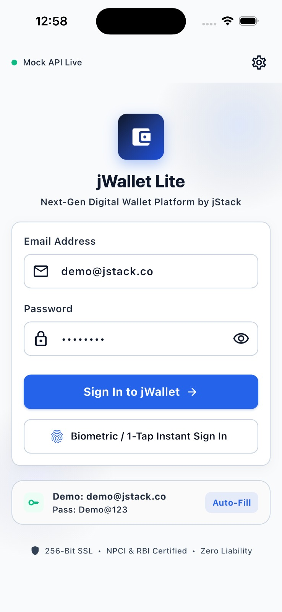
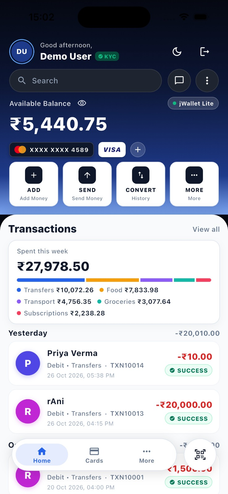
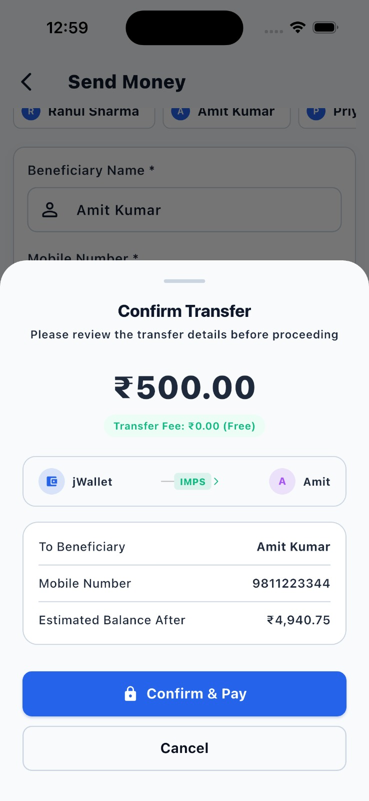

# jWallet Lite — Digital Wallet Mobile Application

[](https://flutter.dev)
[](https://dart.dev)
[](https://flutter.dev)
[]()
[]()
[]()

> **Technical Assessment — Round 1 | Flutter Developer**  
> Candidate Submission for **jStack** | Position: Flutter Developer

---

## 1. Project Overview

**jWallet Lite** is a production-grade fintech digital wallet mobile application developed with **Flutter** and **Dart**, backed by both an independent **Node.js/Express REST API** and a **Smart In-App Mock Fallback Engine**.

The application strictly implements **Clean Architecture** with the **MVVM pattern**, Material Design 3 design system, reactive state management via **Provider**, declarative routing with **GoRouter**, and robust automated test suites.

### 🌟 Key Highlights & Evaluator-Friendly Features:
- **Zero-Setup Standalone Demo Mode:** The app includes an intelligent fallback mechanism (`MockDataStore`). If an evaluator installs the APK on a phone with mobile data (Jio, Airtel) or outside the local network, the app **automatically and seamlessly switches to the in-memory engine** without network errors. 100% of features (Login, Balance, Transactions, Money Transfer, Search/Filter, Theme) work immediately out of the box!
- **Live Backend Mode:** For complete end-to-end evaluation, run the included `mock-backend` server. The app defaults to connecting over your local network IP (`10.22.134.63:3000`), USB (`localhost:3000`), or Android emulator (`10.0.2.2:3000`), with an in-app IP switcher.
- **Native Splash Screen (Android 12+ Optimized):** Zero-flicker launch experience properly integrating Android 12's `SplashScreen` API, with native window background optimization eliminating white screen flashes.
- **Instant Reactive Transaction Filtering:** Flawless in-memory reactive filtering by All, Credits, and Debits with instant live counts and search-as-you-type on both the Dashboard and the Transaction History screen.
- **Backend-Authoritative Balance:** Client never calculates balances arbitrarily; balance updates follow strict idempotency protocols (`UUID v4` idempotency keys).
- **26 Passing Unit & Widget Tests:** Automated tests covering validators, ViewModels, business logic, and UI widgets.

---

## 2. Application Screenshots

<div align="center">

| Login & Authentication | Wallet Dashboard | Send Money Flow |
|:---:|:---:|:---:|
|  |  |  |
| *One-tap demo credentials & host configuration* | *Real-time balance, spending breakdown & transactions* | *Beneficiary selection, instant validation & transfer* |

</div>

---

## 3. Architecture & Design Patterns

The codebase strictly enforces the separation of concerns across three core architectural layers:

```
lib/
├── core/                        # Cross-cutting foundational modules
│   ├── constants/               # API endpoints, design tokens, AppColors
│   ├── network/                 # Dio client, typed ApiExceptions, error interceptors
│   ├── storage/                 # Secure & persistent session storage
│   ├── theme/                   # Material Design 3 light & dark themes
│   └── utils/                   # CurrencyFormatter, DateFormatter, Form Validators
├── data/                        # Concrete data implementations
│   ├── mock/                    # In-app fallback mock data engine (Zero-Setup demo)
│   ├── models/                  # API JSON serialization models
│   ├── repositories/            # Repository implementations (offline fallback & caching)
│   └── services/                # HTTP services (AuthService, WalletService, TransactionService)
├── domain/                      # Authoritative domain & business rules
│   ├── entities/                # Immutable domain entities (User, Wallet, Transaction, TransferResult)
│   └── repositories/            # Abstract repository interfaces
├── presentation/                # UI Presentation Layer (MVVM)
│   ├── routing/                 # GoRouter declarative navigation with reactive auth guards
│   ├── viewmodels/              # ChangeNotifier ViewModels (Auth, Wallet, Transfer, History, Theme)
│   ├── views/                   # Feature Screens:
│   │   ├── auth/                # LoginScreen with preset server selector & auto-fill
│   │   ├── dashboard/           # DashboardScreen with balance card & spending breakdown
│   │   ├── splash/              # Animated in-app SplashScreen with NPCI & SSL badges
│   │   ├── transactions/        # TransactionHistoryScreen (search & filter), TransactionDetailScreen
│   │   └── transfer/            # SendMoneyScreen, Confirmation modal, TransferResultScreen
│   └── widgets/                 # Reusable components (BalanceCard, TransactionTile, StatusBadge, etc.)
└── main.dart                    # Application entrypoint & dependency injection setup
```

### Architectural Highlights:
1. **MVVM with ChangeNotifier & Provider:** Clear separation between UI and business logic, enabling testability and single-direction data flow.
2. **Idempotency Protection:** Transfers generate a unique `Idempotency-Key` header (`UUID v4`) preventing accidental double-charges.
3. **Reactive Navigation (GoRouter):** Centralized route table protected by `refreshListenable` to immediately redirect unauthenticated access.
4. **Typed Domain Exceptions:** HTTP error codes (`400`, `401`, `409`) map directly to typed domain exceptions (`InsufficientFundsException`, `UnauthorizedException`, `ValidationException`, `NetworkConnectionException`).
5. **Theme Engine:** Smooth Dark & Light mode toggle with persistent storage across app launches.

---

## 4. Technology Stack

### Mobile Application (Flutter)
| Technology | Package / Tool | Version | Purpose |
|---|---|---|---|
| **Framework** | Flutter | `3.41.6` (Channel stable) | Cross-platform UI toolkit |
| **Language** | Dart | `3.11.4` | Sound null-safe application logic |
| **State Management** | `provider` | `^6.1.5+1` | Reactive ViewModel state distribution |
| **Navigation** | `go_router` | `^17.5.0` | Declarative URL-based routing & auth guards |
| **Networking** | `dio` | `^5.11.1` | HTTP client with interceptors & timeouts |
| **Persistence** | `shared_preferences` | `^2.5.6` | Session token & theme preference caching |
| **Formatting** | `intl` | `^0.20.3` | INR currency & ISO-8601 date formatting |
| **Idempotency** | `uuid` | `^4.6.0` | Unique transfer transaction identifiers |
| **Splash Screen** | `flutter_native_splash` | `^2.4.7` | Android 12+ & iOS native launch screen |
| **Testing** | `flutter_test`, `mocktail` | `^1.0.5` | Unit and widget test execution |

### Mock REST Backend (Node.js)
- **Runtime:** Node.js `v18+` / `v20+` / `v22+`
- **Framework:** Express.js `4.21.2`
- **CORS:** `cors: ^2.8.5`

---

## 5. Quick Start & Setup Guide

### Option 1: Standalone / Evaluator Mode (Zero Setup Needed)
If you just want to run the Flutter app or install the APK on any phone without starting a backend:
1. Clone the repository and install Flutter dependencies:
   ```bash
   git clone <repository-url>
   cd jstack_assignment
   flutter pub get
   ```
2. Run on any connected device, emulator, or simulator:
   ```bash
   flutter run
   ```
3. The app will automatically run using its internal **Smart Mock Fallback Engine**. You can log in with demo credentials, transfer money, search transactions, and toggle themes with full functionality!

---

### Option 2: Live Backend Mode (Node.js REST API)
If you want to run the full client-server stack with the Express REST API:

#### Step 1: Start the Backend Server
In a separate terminal window:
```bash
cd mock-backend
npm install
npm start
```
The server will start on port `3000` (`http://localhost:3000`).

To verify server health:
```bash
curl http://localhost:3000/health
# Response: {"status":"ok","service":"jWallet Lite Mock API"}
```

#### Step 2: Run the Flutter Application
In your main terminal:
```bash
flutter pub get
flutter run
```

---

## 6. Device Connectivity & Network Settings

The application automatically resolves the correct backend host:

| Target Device | Default Base URL | Connection Method |
|---|---|---|
| **Real Android Phone (Wi-Fi)** | `http://10.22.134.63:3000` | Host computer Wi-Fi IP |
| **Real Android Phone (USB Cable)**| `http://localhost:3000` | Run `adb reverse tcp:3000 tcp:3000` |
| **Android Emulator** | `http://10.0.2.2:3000` | Android loopback alias |
| **iOS Simulator / macOS / Web** | `http://localhost:3000` | Native localhost loopback |
| **No Backend / External Wi-Fi** | *Automatic Fallback* | In-memory Mock Data Engine |

> 💡 **Quick Switcher:** On the **Login Screen**, tap the **Settings icon** in the top-right corner to instantly switch between preset endpoints or enter a custom IP.

---

## 7. Demo Credentials & Recommended Testing Flow

### 🔑 Demo Credentials:
- **Email:** `demo@jstack.co`
- **Password:** `Demo@123`

*(A one-tap **"Fill Form"** button is also available on the Login screen for fast evaluation)*

### 📱 Recommended Evaluator Walkthrough:
1. **Cold Launch & Splash Screen:**
   - Launch app from launcher to view the branded native splash screen transitioning seamlessly into the in-app `SplashScreen` with NPCI & SSL badges.
2. **Authentication:**
   - Tap "Fill Form" or enter `demo@jstack.co` / `Demo@123`. Tap **Sign In**.
3. **Dashboard:**
   - View initial balance: `₹25,450.75`.
   - Tap the eye icon to toggle balance masking (`••••••`).
   - Tap the Theme toggle icon in the top AppBar to switch between **Dark Mode** and **Light Mode**.
   - Pull down to trigger pull-to-refresh.
4. **Send Money:**
   - Tap the **Send Money** quick action.
   - Tap a frequent beneficiary chip (e.g., `Rahul Sharma`).
   - Enter an amount (e.g., `₹1,500.00`).
   - Tap **Review & Transfer** to open the review bottom sheet.
   - Tap **Confirm & Pay** — verify instant balance deduction (`₹23,950.75`) and transition to the receipt screen.
   - Tap **Back to Dashboard** and verify the new debit transaction is pinned at the top of the list.
5. **Validation & Edge Cases:**
   - Try logging in with invalid credentials $\rightarrow$ clear error banner.
   - Try sending more than available balance (e.g. `₹50,000.00`) $\rightarrow$ validation prevents submission with "Insufficient wallet balance".
   - Try entering an invalid phone number $\rightarrow$ inline field validation triggers.
6. **Transactions History & Search:**
   - Tap **See All** or the **History** tab in the bottom bar.
   - Use the live search bar (search "Swiggy", "Salary", or "Uber").
   - Filter by **Credits** or **Debits** using the filter tabs.
   - Tap any transaction to inspect the complete receipt with transaction ID and timestamp.

---

## 8. Automated Testing & Code Quality

The test suite covers unit tests for business logic, form validation, ViewModels, error mapping, and widget tests:

```bash
# Run all unit and widget tests
flutter test

# Run static analysis
flutter analyze
```

### Test Suite Summary:
- ✅ **Form Validation Tests:** Email regex, password length, phone format, transfer amount boundaries.
- ✅ **ViewModel Tests:** Auth state transitions, wallet balance updates, transfer submission guards, transaction filtering, search query matching, and error handling.
- ✅ **Widget Tests:** Balance card toggle, transaction tile rendering, status badge color mapping.
- **Results:** 26 / 26 tests passing. 0 issues reported by `flutter analyze`.

---

## 9. Backend Endpoints Summary

| Method | Endpoint | Description | Status Codes |
|---|---|---|---|
| `POST` | `/api/v1/auth/login` | Authenticate user & issue token | `200`, `400`, `401` |
| `GET` | `/api/v1/users/profile` | Fetch user profile info | `200`, `401` |
| `GET` | `/api/v1/wallet/balance` | Fetch authoritative wallet balance | `200`, `401` |
| `GET` | `/api/v1/transactions` | List transactions (`?type=CREDIT/DEBIT`, `?search=`) | `200`, `401` |
| `POST` | `/api/v1/transactions/transfer` | Execute money transfer (with Idempotency key) | `200`, `400`, `401`, `409` |
| `GET` | `/api/v1/transactions/:id` | Fetch specific transaction details | `200`, `401`, `404` |
| `POST` | `/api/v1/wallet/reset` | Reset mock database to default state | `200` |

### API Documentation & Media Assets:
- **OpenAPI 3.0 Specification:** `api-docs/openapi.json`
- **Postman Collection:** `api-docs/jwallet_postman_collection.json`
- **Application Walkthrough Video:** `docs/demo_video.mp4`

---

## 10. Pre-Built APK File Location

A production release APK has been compiled and is ready for direct installation:
```text
build/app/outputs/flutter-apk/app-release.apk
```

To install on a connected Android phone via ADB:
```bash
adb install -r build/app/outputs/flutter-apk/app-release.apk
```

---

## 11. Deliverables & Assessment Checklist

- [x] **A. Source Code:** Clean Flutter codebase following Clean Architecture & MVVM.
- [x] **B. Standalone & Live Support:** Smart in-app mock fallback + Node.js Express server.
- [x] **C. Automated Tests:** 26/26 passing unit and widget tests (`flutter test`).
- [x] **D. Native Splash Screen:** Android 12+ SplashScreen API + launch background with zero white flash.
- [x] **E. Screenshots:** High-resolution screen captures in `docs/screenshots/` (Login, Dashboard, Send Money).
- [x] **F. Video Demonstration:** Complete application walkthrough screen recording in `docs/demo_video.mp4`.
- [x] **G. API Documentation:** OpenAPI 3.0 specification & Postman collection in `api-docs/`.
- [x] **H. Release Build:** Standalone APK ready for evaluator distribution.
- [x] **I. Documentation:** Comprehensive README with architecture, setup, credentials, and walkthrough.
